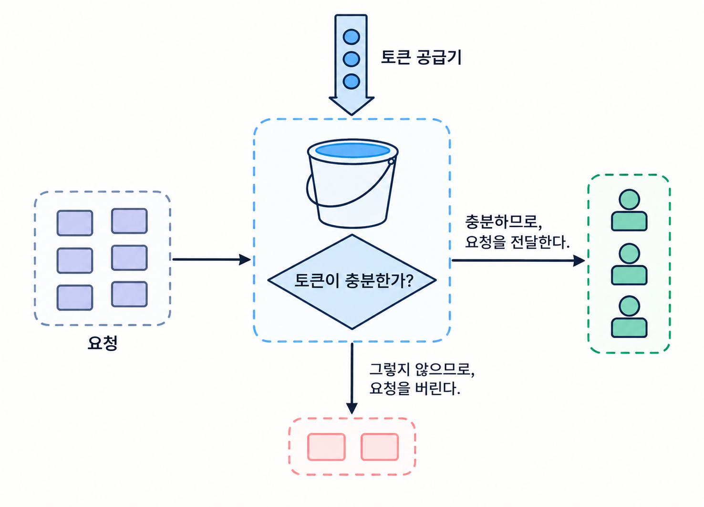
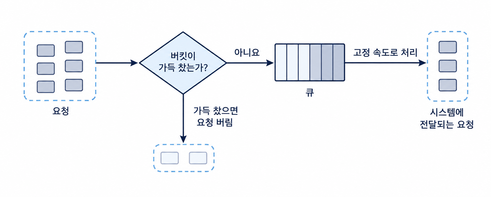
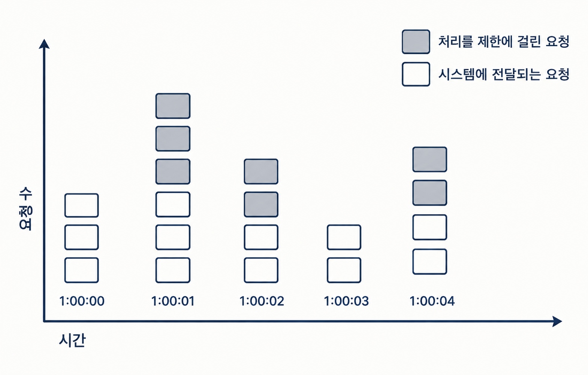
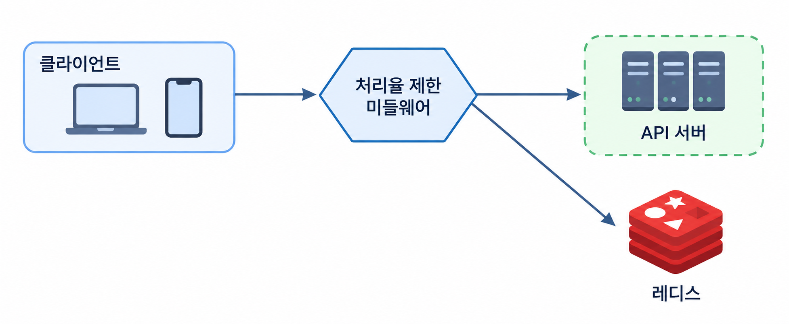
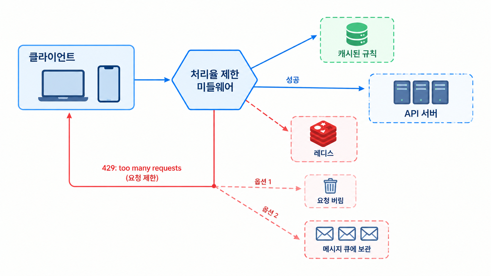

# 처리율 제한 장치의 설계

클라이언트 또는 서비스가 보내는 트래픽의 처리율(rate)를 제어하기 위한 것  
API 요청 횟수가 제한 장치에 정의된 threshold를 넘어서면 추가로 도달한 모든 호출이 처리가 중단 되는 것과 같음

## API에 처리율 제한 장치를 두면 좋은점
- DOS 공격에 의한 자원 고갈을 방지 할 수 있다.
- 비용을 절감한다.
    - 추가 요청에 대한 처리를 제한하면 서버를 많이 두지 않아도 되어 우선순위가 높은 API 에 더많은 자원을 할당 할 수 있다.
- 서버 과부하를 막는다.
    - 봇에서 오는 트래픽이나 사용자의 잘못된 이용 패턴으로 유발된 트래픽을 걸러낼 수 있다.

## 처리율 제한 장치를 두는곳
처리율 제한 장치를 두는곳은 회사의 기술 스택이나 엔지니어링 인력, 우선순위, 목표에 따라 달라 질 수 있다.  

아래는 처리율 제한장치를 둘 때 몇가지의 지침이다.
- 프로그래밍 언어, 캐시 서비스등 현재 사용하고 있는 기술스택을 점검하라
- 여러분의 사업 필요에 맞는 처리율 제한 알고리즘을 찾아라
- MSA 기반이고, 사용자 인증이나 IP허용목록 관리등을 처리하기 위해 API 게이트웨이를 설계에 포함하였다면 처리율 제한 기능또한 게이트웨이에 포함함을 검토하라
- 처리율 제한 서비스를 직접 만드는 데는 시간이 든다는점을 인지하라

## 처리율 제한 알고리즘

### 토큰 버킷 알고리즘

 

특징  
- 토큰 버킷 알고리즘은 2개의 인자를 받는다.
    - 버킷 크기: 버킷에 담을 수 있는 토큰의 최대 개수
    - 토큰 공급률: 초당 몇개의 토큰이 버킷에 공급되는가
- 토큰 버킷은 지정된 용량을 갖는 컨테이너이다.  이 버킷에는 사전 설정된 양의 토큰이 주기적으로 채워진다.  
- 버킷이 가득 차면 추가로 공급된 토큰은 버려진다.  
- 각 요청은 처리될 때마다 하나의 토큰을 사용한다. 요청이 도착하면 버킷에 충분한 토큰이 있는지 검사하게 된다.  

장점
- 구현이 쉽다.
- 메모리 사용 측면에서도 효율적이다.
- 짧은 시간에 집중되는 트래픽 (burst of traffic)도 처리 가능하다. 버킷에 남은 토큰이 있기만하면 요청은 시스템에 전달된다.  

단점
- 버킷 크기와 토큰 공급률이라는 두개 인자의 튜닝이 까다롭다

### 누출 버킷 알고리즘 

 

특징
- 누출 버킷 알고리즘은 2개의 인자를 받는다.
    - 버킷 크기: 큐 사이즈와 같은 값이다. 큐에는 처리될 항목들이 보관된다.
    - 처리율: 지정된 시간당 몇개의 항목을 처리할지 지정하는 값이다. 보통 초단위로 표현된다.
- 토큰 버킷 알고리즘과 비슷하지만 요청 처리율이 고정 되어있다.
- FIFO 큐로 구현한다.
- 요청이 도착하면 큐가 가득 차 있는지 본다. 빈자리가 있는 경우에는 큐에 요청을 추가한다.
- 큐가 가득 차있는 경우에는 새 요청은 버린다.
- 지정된 시간마다 큐에서 요청을 꺼내어 처리한다.

장점
- 큐의 크기가 제한되어 있어 메모리 사용량 측면에서 효율적인다.
- 고정된 처리율을 갖고 있기 때문에 안정적 출력(stable outflow rate)가 필요한 경우에 적합하다.
    - 처리율 일정해야하는 경우

단점
- 단시간에 많은 트래픽이 몰리는 경우 큐에는 오래된 요청들이 쌓이게 되고, 그 요청을 제때 처리 못하면 최신 요청들이 버려지게 된다.
- 버킷 크기, 처리율 두 인자를 튜닝하기가 까다롭다.

### 고정 윈도 카운터 알고리즘

 

특징
- 타임라인을 고정된 간격의 윈도우로 나누고 각 윈도우마다 카운터를 붙인다.
- 요청이 접수될 때마다 이 카운터의 값은 1씩 증가한다.
- 이 카운터의 값이 사전 설정된 임계치에 도달하면 새로운 요청은 새 윈도우가 열릴 떄 까지 버려진다.

장점
- 메모리 효율이 좋다.
- 이해하기 쉽다.
- 윈도우가 닫히는 시점에 카운터를 초기화하는 방식은 특정한 트래픽 패턴을 처리하기에 적합하다.
    - 특정 시간당 제한이 있는 서비스를 호출하거나 할 때

단점
- 윈도우 경계 부근에서 일시적으로 많은 트래픽이 몰려드는 경우, 기대했던 시스템의 처리 한도보다 많은 양의 요청을 처리하게 된다.

### 이동 윈도 로깅 알고리즘

특징
- 고정 윈도 카운터 알고리즘에서 윈도우 경계 부근에서 일시적으로 많은 트래픽이 몰리는 현상을 해결함
- 요청의 타임스탬프를 추적한다. (보통 레디스의 sorted set 같은 캐시에 보관)
- 새 요청이 오면 만료된 타임스탬프는 제거한다.
- 만료된 타임스탬프는 그 값이 현재 윈도우의 시작 시점보다 오래된 타임스탬프를 말한다.
- 새 요청의 타임스탬프를 로그(log)에 추가한다.
- 로그의 크기가 허용치보다 같거나, 작으면 요청을 시스템에 전달한다. 그 외 경우는 처리를 거부한다.

장점
- 알고리즘이 구현하는 처리율 제한 메커니즘이 정교하다 (시스템 처리율 한도를 넘지않음)

단점
- 다량의 메모리를 사용 (거부된 요청의 타임스탬프도 보관하기 때문에)

### 이동 윈도 카운터 알고리즘  

특징
- 고정 윈도 카운터의 처리율이 몰리는 문제와 이동 윈도 로깅 알고리즘의 메모리가 증가하는 문제를 해결하기 위함
- 아래와 같은 공식에 의함
    - 현재 1분간의 요청수 + 직전 1분간의 요청수 x 이동 윈도와 직전 1분이 겹치는 비율

장점
- 이전 시간대의 평균 처리율에 따라 현재 윈도 상태를 계산하므로 짧은 시간내 몰리는 트래픽에도 잘 대응한다.
- 메모리 효율이 좋다.

단점
- 직전 시간대에 도착한 요청이 균둥하게 분포되어 있다고 가정하고 추정치를 계산해 느슨하다.
    - 하지만 클라우드플레어 실험에 따르면 40억개중 0.003%의 요청만이 시스템 상태와 다르게 허용되거나 버려졌으므로 생각보다 심각하지 않음

## 개략적인 아키텍처
그렇다면 얼마나 많은 요청이 접수되었는지를 추적할 수 있는 카운터를 추적 대상별로 둘 때 이 카운터는 어디에 보관할 것인가??  
->빠르게 접근 가능하며, 시간에 기반한 만료 정책을 제공하는 캐시가 바람직하다.  

아래는 레디스의 명령어 예시이다.
- INCR: 메모리에 저장된 카운터의 값을 1만큼 증가시킨다.
- EXPIRE: 카운터에 타임아웃 값을 설정한다. 설정된 시간이 지나면 카운터
는 자동으로 삭제된다.

### 개략적 구조

 

- 클라이언트가 처리율 제한 미들웨어에게 요청을 보낸다.
- 처리율 제한 미들웨어는 레디스의 지정 버킷에서 카운터를 가져와서 한도
에 도달했는지 아닌지를 검사한다.
    - 한도에 도달했다면 요청은 거부된다.
    - 한도에 도달하지 않았다면 요청은 API 서버로 전달된다. 미들웨어는 카운터의 값을 증가시킨 후 다시 레디스에 저장한다

#### 처리율 한도 초과 트래픽의 처리
어떤 요청이 한도 제한에 걸리면 API 는 429(Too many requests)를 클라이언트에게 보낸다.  
경우에 따라서는 한도 제한에 걸린 메세지를 나중에 처리하기 위해 큐에 보관할 수 도 있다.   

그렇다면 클라이언트는 자기 요청이 처리율 제한에 걸리고 있는지를(throttle) 어떻게 감지할 수 있을까?  
-> 정답은 HTTP 응답 헤더에 있다.
- X-Ratelimit-Remaining: 윈도 내에 남은 처리 가능 요청의 수
- X-Ratelimit-Limit: 매 윈도마다 클라이언트가 전송할 수 있는 요청의 수
- X-Ratelimit-Retry-After: 한도 제한에 걸리지 않으려면 몇 초 뒤에 요청을 다시 보내야 하는지 알림  

사용자가 너무 많은 요청을 보내면 429 too many requests 오류를 X-Ratelimit-Retry-After 헤더와 함께 반환하도록 한다.

#### 상세 설계

 

- 처리율 제한 규칙은 디스크에 보관한다. 작업 프로세스(workers)는 수시로 규칙을 디스크에서 읽어 캐시에 저장한다.
- 클라이언트가 요청을 서버에 보내면 요청은 먼저 처리율 제한 미들웨어에 도달한다.
- 처리율 제한 미들웨어는 제한 규칙을 캐시에서 가져온다. 아울러 카운터 및 마지막 요청의 타임스탬프(timestamp)를 레디스 캐시에서 가져온다.  
가져온 값들에 근거하여 해당 미들웨어는 다음과 같은 결정을 내린다.
    - 해당 요청이 처리율 제한에 걸리지 않은 경우에는 API 서버로 보낸다.
    - 해당 요청이 처리율 제한에 걸렸다면 429 too many requests 에러를 클라이언트에 보낸다. 한편 해당 요청은 그대로 버릴 수도 있고 메시지 큐에 보관할 수도 있다.

#### 분산 환경에서의 처리율 제한 장치의 구현

단일 서버가 아닌 여러 서버와 병렬 스레드를 지원하도록 시스템을 확장할 때는 다음과 같은 문제가 발생한다.

* **경쟁 조건 (Race Condition)**

  * 레디스에서 카운터 값을 조회한 뒤, 카운터를 1 증가시켰을 때 임계치를 초과하는지 확인하고, 초과하지 않는 경우 카운터를 갱신한다고 가정한다.
  * 여러 스레드가 동시에 카운터에 접근하면 동일한 값을 읽거나, 임계치 확인과 카운터 갱신 사이에 다른 요청이 끼어들어 요청 횟수가 정확하게 집계되지 않거나 임계치를 초과할 수 있다.
  * 분산 락을 사용해 해결할 수 있지만, 락 획득 및 해제에 따른 오버헤드와 경합으로 인해 성능이 저하될 수 있다.
  * 일반적으로 레디스의 **루아 스크립트(Lua Script)** 를 이용해 임계치 확인과 카운터 갱신을 원자적으로 처리하거나, **정렬 집합(Sorted Set)** 을 활용해 요청별 타임스탬프를 기록하고 제한 시간 내의 요청 수를 계산하는 방식으로 해결할 수 있다.

* **동기화 (Synchronization)**

  * 여러 서버가 각각 처리율 제한 장치를 운영하면 서버마다 카운터가 분리되어 전체 요청 횟수를 정확하게 제한하기 어려울 수 있다.
  * 예를 들어, 사용자당 분당 100회로 제한하더라도 서버 3대가 각각 100회씩 허용하면 전체적으로 최대 300회까지 요청이 허용될 수 있다.
  * 이를 해결하기 위해 여러 서버가 **레디스와 같은 중앙 집중식 저장소를 공유**하여 카운터와 요청 상태를 관리하도록 구성할 수 있다.

#### 성능 최적화
처리율 제한 장치는 다음과 같은 두 가지 측면에서 개선할 수 있다.

* **여러 데이터센터 지원**

  * 사용자와 데이터센터 사이의 물리적 거리가 멀어지면 네트워크 지연시간(Latency)이 증가할 수 있다.
  * 이를 해결하기 위해 클라우드 서비스 사업자는 전 세계 여러 지역에 엣지 서버(Edge Server)를 배치한다.
  * 사용자의 트래픽을 가장 가까운 엣지 서버로 전달함으로써 네트워크 지연시간을 줄일 수 있다.

* **최종 일관성 모델(Eventual Consistency Model) 적용**

  * 여러 처리율 제한 장치 간에 데이터를 동기화할 때 최종 일관성 모델을 적용할 수 있다.
  * 모든 처리율 제한 장치의 데이터가 즉시 일치하지 않더라도, 일정 시간이 지나면 동일한 상태로 수렴하도록 하는 방식이다.
  * 이를 통해 데이터 동기화에 따른 부담을 줄일 수 있지만, 동기화가 완료되기 전까지 일시적으로 처리율 제한 기준이 정확하게 적용되지 않을 수 있다.

#### 모니터링

처리율 제한 장치를 도입한 이후에는 정상적으로 동작하는지 확인하기 위해 지속적인 모니터링이 필요하다. 주요 확인 사항은 다음과 같다.

* **처리율 제한 알고리즘의 효과성**

  * 선택한 알고리즘이 실제 트래픽 패턴에 적합하게 동작하는지 확인한다.
  * 예를 들어, 트래픽이 급증하는 상황에서도 시스템이 안정적으로 요청을 처리하고 불필요한 요청을 적절히 제한하는지 확인한다.

* **처리율 제한 규칙의 효과성**

  * 설정한 제한 규칙이 적절한지 확인한다.
  * 제한이 지나치게 엄격하면 정상적인 요청까지 거부될 수 있으므로, 유효 요청이 과도하게 차단되는 경우 제한 기준을 완화할 필요가 있다.
  * 반대로 제한이 너무 느슨하면 과도한 트래픽으로 인해 시스템에 부하가 발생할 수 있으므로, 트래픽 특성에 맞게 규칙을 조정해야 한다.

* **트래픽 패턴에 따른 알고리즘 개선**

  * 깜짝 세일과 같은 이벤트로 트래픽이 급증할 때 처리율 제한 장치가 비효율적으로 동작한다면 알고리즘 변경을 고려할 수 있다.
  * 이러한 상황에서는 일정량의 요청을 즉시 허용하고 이후 요청을 제한하는 **토큰 버킷(Token Bucket)** 알고리즘이 적합할 수 있다.
