# 키-값 저장소 설계

**키-값 저장소(Key-Value Store)** 는 키와 값의 쌍으로 데이터를 저장하는 비관계형 데이터베이스(NoSQL)이다.

저장되는 각 값은 고유한 식별자인 **키(Key)** 를 가지며, 키와 값의 연결 관계를 **키-값 쌍(Key-Value Pair)** 이라고 한다.

## 키(Key)의 특징

- **고유성**: 각 키는 유일해야 한다.
- **접근 방식**: 저장된 값은 해당 키를 통해서만 접근할 수 있다.
- **형식**: 키는 일반 텍스트 문자열일 수도 있고, 해시 값일 수도 있다.
- **길이**: 성능과 메모리 효율을 고려하면 키는 짧을수록 좋다.

## 값(Value)의 특징

값은 다양한 데이터 형식을 가질 수 있다.

- 문자열(String)
- 리스트(List)
- 객체(Object)

## 대표적인 키-값 저장소

- **Amazon DynamoDB**: AWS에서 제공하는 NoSQL 데이터베이스
- **Memcached**: 메모리 기반의 캐시 시스템
- **Redis**: 다양한 자료구조를 지원하는 인메모리 데이터 저장소

## 키-값 저장소 설계

이번 장에서는 다음 두 가지 연산을 지원하는 키-값 저장소를 설계한다.

- `put(key, value)`: 키-값 쌍을 저장소에 저장한다.
- `get(key)`: 주어진 키에 연결된 값을 조회한다.

### 설계 범위 확정

완벽한 설계란 없다. 읽기, 쓰기, 메모리 사용량 사이에서 균형을 찾고, 데이터 일관성과 가용성 사이에서 적절한 타협점을 찾아야 한다.

이번 장에서 설계할 키-값 저장소는 다음과 같은 특성을 갖는다.

- **키-값 쌍의 크기:** 10KB 이하
- **대용량 데이터 저장:** 많은 데이터를 저장할 수 있어야 한다.
- **높은 가용성:** 장애가 발생하더라도 빠르게 응답할 수 있어야 한다.
- **높은 확장성:** 트래픽에 따라 서버를 자동으로 추가하거나 제거할 수 있어야 한다.
- **조절 가능한 데이터 일관성:** 데이터 일관성 수준을 조절할 수 있어야 한다.
- **짧은 응답 지연시간:** 읽기와 쓰기 요청에 빠르게 응답해야 한다.

## 단일 서버 키-값 저장소

한 대의 서버만 사용하는 키-값 저장소를 설계하는 것은 비교적 간단하다.

가장 직관적인 방법은 **모든 키-값 쌍을 메모리의 해시 테이블(Hash Table)에 저장하는 것**이다. 메모리를 사용하므로 빠른 읽기와 쓰기가 가능하지만, 모든 데이터를 메모리에 저장하기 어려울 수 있다는 한계가 있다.

이 문제를 해결하기 위한 개선 방법은 다음과 같다.

- **데이터 압축(Compression):** 데이터를 압축하여 저장 공간을 절약한다.
- **메모리와 디스크 활용:** 자주 사용하는 데이터는 메모리에 저장하고, 나머지 데이터는 디스크에 저장한다.

하지만 이러한 방법을 사용하더라도 데이터가 계속 증가하면 한 대의 서버만으로는 충분하지 않은 상황이 발생한다.

따라서 많은 데이터를 저장하고 처리하기 위해서는 여러 서버에 데이터를 분산하는 **분산 키-값 저장소(Distributed Key-Value Store)** 가 필요하다.

## 분산 키-값 저장소

**분산 키-값 저장소(Distributed Key-Value Store)** 는 키-값 쌍을 여러 서버에 분산하여 저장하는 시스템이다. **분산 해시 테이블(Distributed Hash Table)** 이라고도 한다.

분산 시스템을 설계할 때는 CAP 정리를 이해해야 한다.

### CAP 정리

**CAP 정리** 는 분산 시스템에서 다음 세 가지 요구사항을 동시에 모두 만족할 수 없다는 정리다.

- **일관성(Consistency):** 어떤 노드에 접속하더라도 모든 클라이언트가 동일한 데이터를 볼 수 있어야 한다.
- **가용성(Availability):** 일부 노드에 장애가 발생하더라도 클라이언트의 요청에 응답할 수 있어야 한다.
- **파티션 감내(Partition Tolerance):** 노드 사이에 네트워크 통신 장애가 발생하더라도 시스템이 계속 동작할 수 있어야 한다.

#### CAP의 세 가지 선택

CAP 정리에 따르면 세 가지 중 두 가지를 선택하면 나머지 하나를 희생해야 한다.

| 유형 | 지원하는 특성 | 희생하는 특성 |
|---|---|---|
| **CP** | 일관성 + 파티션 감내 | 가용성 |
| **AP** | 가용성 + 파티션 감내 | 일관성 |
| **CA** | 일관성 + 가용성 | 파티션 감내 |

실제 분산 시스템에서는 네트워크 장애를 완전히 피할 수 없으므로 **파티션 감내는 필수적으로 고려해야 한다.** 따라서 네트워크 파티션이 발생했을 때는 일반적으로 일관성과 가용성 중 어느 쪽을 우선할지 결정해야 한다.

### 네트워크 장애 상황에서의 CAP

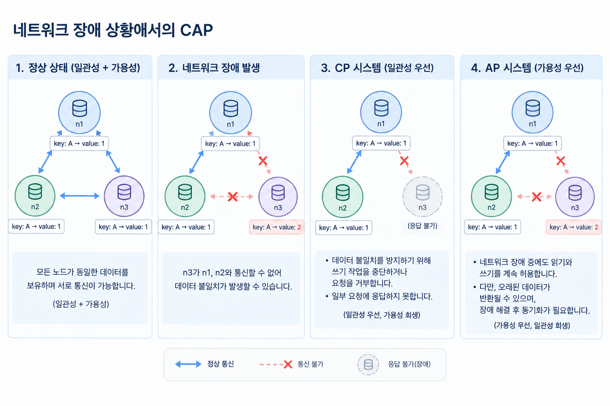 

데이터가 세 개의 복제 노드 `n1`, `n2`, `n3`에 저장되어 있다고 가정하자.

#### 1. 이상적인 상태

네트워크 장애가 없다면 `n1`에 기록된 데이터가 `n2`, `n3`에도 복제된다. 이 상태에서는 일관성과 가용성을 모두 만족할 수 있다.

#### 2. 네트워크 파티션 발생

`n3`가 `n1`, `n2`와 통신할 수 없게 되면 문제가 발생한다.

- `n1`, `n2`에서 변경된 데이터가 `n3`에 전달되지 않는다.
- `n3`에만 기록된 데이터가 있다면 `n1`, `n2`가 오래된 데이터를 가지고 있을 수 있다.

이때 시스템은 일관성과 가용성 중 하나를 우선해야 한다.

#### 3. CP 시스템: 일관성 우선

데이터 불일치를 방지하기 위해 필요한 요청을 거부하거나 쓰기 작업을 중단할 수 있다. 이 경우 최신 데이터를 보장할 수 있지만, 일부 요청에 응답하지 못하므로 가용성이 희생된다.

**예시:** 계좌 잔액처럼 오래된 데이터를 제공하는 것이 큰 문제가 되는 시스템.

#### 4. AP 시스템: 가용성 우선

네트워크 장애 중에도 읽기와 쓰기를 계속 허용한다. 다만 오래된 데이터가 반환될 수 있으며, 장애가 해결된 뒤 변경된 데이터를 복제하여 동기화해야 한다.

**핵심:** CP와 AP 중 어느 쪽이 적합한지는 시스템의 요구사항에 따라 결정해야 한다.  

## 시스템 컴포넌트

분산 키-값 저장소를 구현할 때 필요한 핵심 컴포넌트와 기술은 다음과 같다.

- 데이터 파티션(Data Partition)
- 데이터 다중화(Replication)
- 일관성(Consistency)
- 일관성 불일치 해소(Inconsistency Resolution)
- 장애 처리(Failure Handling)
- 시스템 아키텍처 다이어그램
- 쓰기 경로(Write Path)
- 읽기 경로(Read Path)

이 절에서는 다이나모(Dynamo), 카산드라(Cassandra), 빅테이블(Bigtable)의 사례를 참고한다.

---

### 데이터 파티션 (Data Partition)

대규모 애플리케이션에서는 전체 데이터를 한 대의 서버에 저장하기 어렵다. 따라서 데이터를 작은 파티션으로 나누어 여러 서버에 저장한다.

데이터를 파티션 단위로 나눌 때는 다음 두 가지를 고려해야 한다.

- 데이터를 여러 서버에 **고르게 분산**할 수 있는가?
- 노드가 추가되거나 삭제될 때 **데이터 이동을 최소화**할 수 있는가?

이 문제를 해결하는 데 적합한 기술이 **안정 해시(Consistent Hashing)** 다.

#### 안정 해시를 이용한 데이터 파티션

1. 서버들을 해시 링(Hash Ring)에 배치한다.
2. 저장할 키를 해시하여 해시 링 위에 배치한다.
3. 키가 위치한 지점부터 시계 방향으로 순회한다.
4. 순회 중 처음 만나는 서버에 해당 키-값 쌍을 저장한다.

예를 들어, `key0`을 해시 링에 배치한 뒤 시계 방향으로 이동하여 처음 만나는 서버가 `s1`이라면 `key0`은 `s1`에 저장된다.

#### 안정 해시를 이용한 파티션의 장점

- **규모 확장 자동화(Automatic Scaling):** 시스템 부하에 따라 서버를 자동으로 추가하거나 삭제할 수 있다.
- **다양성(Heterogeneity):** 서버의 용량에 맞춰 가상 노드(Virtual Node)의 수를 조정할 수 있다. 고성능 서버에는 더 많은 가상 노드를 할당할 수 있다.

---

### 데이터 다중화 (Replication)

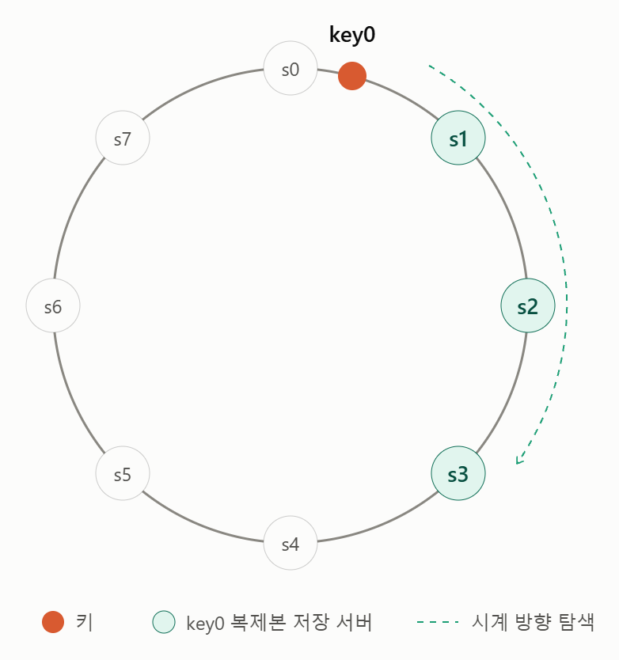  

높은 가용성과 안정성을 확보하기 위해서는 데이터를 **N개 서버에 비동기적으로 다중화**할 필요가 있다.  
여기서 N은 조정 가능한 값이다.

#### 데이터 다중화 방법

1. 저장할 키를 해시 링 위에 배치한다.
2. 해당 지점부터 시계 방향으로 링을 순회한다.
3. 처음 만나는 N개 서버에 데이터 사본을 저장한다.

예를 들어, **N = 3**으로 설정하면 `key0`의 데이터 사본은 `s1`, `s2`, `s3`에 저장된다.

#### 가상 노드 사용 시 주의점

가상 노드를 사용하면 선택한 N개의 노드가 실제 물리 서버 N대에 대응하지 않을 수 있다. 따라서 **같은 물리 서버가 중복 선택되지 않도록** 노드를 선택해야 한다.

#### 데이터 센터 간 다중화

같은 데이터 센터에 속한 노드는 정전, 네트워크 문제, 자연재해 등의 장애를 동시에 겪을 가능성이 있다.

따라서 안정성을 확보하기 위해 데이터 사본을 **서로 다른 데이터 센터의 서버에 보관**하고, 데이터 센터들은 고속 네트워크로 연결한다.

---

### 데이터 일관성 (Consistency)

데이터를 여러 서버에 복제하면, 각 서버에 저장된 데이터가 서로 달라질 수 있다. 예를 들어 한 서버에는 **최신 데이터**가 저장되어 있지만, 다른 서버에는 **이전 데이터**가 남아 있을 수 있다.

따라서 분산 키-값 저장소에서는 **데이터 일관성을 유지하면서 읽기와 쓰기 요청을 처리하는 방법**이 중요하다.

이를 위해 **정족수 합의(Quorum Consensus)** 프로토콜을 사용하며, 읽기와 쓰기에 필요한 서버 응답 수를 조정하여 **일관성 수준과 응답 속도 사이의 균형**을 맞춘다.

#### 정족수 합의 (Quorum Consensus)

정족수 합의는 읽기와 쓰기 연산을 성공으로 판단하는 데 필요한 **최소 서버 응답 수를 정하는 방식**이다.

주요 개념은 다음과 같다.

- **N (사본 개수):** 데이터를 복제하여 보관하는 서버의 수
- **W (쓰기 정족수):** 쓰기 성공으로 판단하기 위해 필요한 최소 성공 응답 수
- **R (읽기 정족수):** 읽기 성공으로 판단하기 위해 필요한 최소 서버 응답 수

예를 들어 `N = 3`이라면 데이터 사본을 세 대의 서버에 저장한다.

이때 `W = 2`, `R = 2`로 설정하면 다음과 같이 동작한다.

- **쓰기:** 세 대 중 최소 두 대에서 성공 응답을 받아야 쓰기 성공으로 판단한다.
- **읽기:** 최소 두 대의 서버에서 응답을 받아야 읽기 성공으로 판단한다.

#### 중재자(Coordinator)의 역할

중재자는 클라이언트와 서버 사이에서 요청을 전달하고 각 서버의 응답을 취합하는 **프록시(Proxy) 역할**을 한다.

예를 들어 `W = 1`이라면 중재자는 한 대의 서버에서 쓰기 성공 응답을 받았을 때 쓰기 성공으로 판단할 수 있다. 나머지 서버의 응답까지 기다릴 필요는 없다.

**단, `W = 1`이라고 해서 데이터가 한 대에만 저장된다는 뜻은 아니다.** 데이터는 여러 서버에 복제될 수 있으며, 쓰기 성공을 판단하기 위해 필요한 응답이 한 개라는 의미다.

#### N, W, R에 따른 일관성과 응답 속도

W 또는 R이 1이면 한 대의 서버 응답만으로 성공 여부를 판단할 수 있으므로 **응답 속도가 빠르다.** 반대로 W 또는 R이 커지면 더 많은 서버의 응답을 기다려야 하므로 응답 속도가 느려질 수 있지만, **데이터 일관성을 높이는 데 도움이 된다.**

일반적인 설정 조합은 다음과 같다.

| 설정 | 특징 |
|---|---|
| `R = 1, W = N` | **읽기 연산에 유리하다.** |
| `W = 1, R = N` | **쓰기 연산에 유리하다.** |
| `W + R > N` | **강한 일관성을 보장할 수 있다.** |
| `W + R ≤ N` | **강한 일관성이 보장되지 않는다.** |

`W + R > N`이면 읽기 정족수와 쓰기 정족수에 포함되는 서버가 **최소 한 대 겹친다.** 따라서 최신 데이터가 있는 서버를 읽기 과정에서 확인할 수 있어 강한 일관성을 보장할 수 있다.

예를 들어 `N = 3`, `W = 2`, `R = 2`라면 두 정족수의 합은 4로 N보다 크므로 최소 한 대의 서버가 겹친다.

반면 `N = 3`, `W = 1`, `R = 1`이면 읽기와 쓰기가 서로 다른 서버에서 처리될 수 있으므로 **이전 데이터가 반환될 가능성**이 있다.

#### 일관성 모델 (Consistency Model)

일관성 모델은 키-값 저장소에서 **데이터 일관성을 어느 수준까지 보장할지 결정**한다.

- **강한 일관성(Strong Consistency):** 모든 읽기 연산이 **가장 최근에 갱신된 결과**를 반환한다. 클라이언트는 오래된 데이터를 읽지 않는다.
- **약한 일관성(Weak Consistency):** 읽기 연산이 가장 최근에 갱신된 결과를 반환하지 못할 수 있다.
- **결과적 일관성(Eventual Consistency):** 약한 일관성의 한 형태로, 갱신 결과가 시간이 지나면 **결국 모든 데이터 사본에 반영되어 동기화**된다.

강한 일관성을 달성하는 일반적인 방법 중 하나는 **모든 데이터 사본에 현재 쓰기 연산의 결과가 반영될 때까지 해당 데이터에 대한 읽기와 쓰기를 금지**하는 것이다.

하지만 이 방식은 데이터가 모든 사본에 반영될 때까지 요청 처리가 중단될 수 있으므로, **높은 가용성이 필요한 시스템에는 적합하지 않을 수 있다.**

---

### 일관성 불일치 해소 (Inconsistency Resolution)

데이터를 여러 서버에 다중화하면 가용성은 높아지지만, 각 데이터 사본 사이에 **일관성 불일치**가 발생할 수 있다.

특히 여러 클라이언트가 동시에 데이터를 수정하면 서로 다른 값이 만들어질 수 있다. 이러한 문제를 해결하기 위해 **버저닝(Versioning)** 과 **벡터 시계(Vector Clock)** 를 사용한다.

#### 버저닝 (Versioning)

**버저닝은 데이터를 변경할 때마다 새로운 버전을 생성하는 방식**이다. 따라서 각 버전의 데이터는 변경 불가능(Immutable)하다.

예를 들어, `name`이라는 데이터가 두 노드 `n1`, `n2`에 복제되어 있다고 가정하자.

처음에는 두 노드 모두 다음과 같은 값을 가지고 있다.

- `n1`: `name = john`
- `n2`: `name = john`

이후 두 클라이언트가 동시에 데이터를 수정한다.

- 서버 1: `name = johnSanFrancisco`
- 서버 2: `name = johnNewYork`

각각의 변경으로 서로 다른 버전이 생성된다.

- 버전 `v1`: `name = johnSanFrancisco`
- 버전 `v2`: `name = johnNewYork`

두 변경은 동시에 발생했으므로 어느 한쪽이 다른 쪽보다 최신이라고 판단하기 어렵다. 따라서 **서로 충돌하는 두 버전을 감지하고 해결할 방법이 필요하다.**

---

#### 벡터 시계 (Vector Clock)

**벡터 시계(Vector Clock)는 데이터의 변경 순서를 추적하여 버전 간 선후 관계와 충돌 여부를 판단하는 기법**이다.

벡터 시계는 데이터에 서버와 버전의 순서쌍을 연결하여 다음과 같이 표현한다.

`D([S1, v1], [S2, v2], ..., [Sn, vn])`

- `D`: 데이터
- `S`: 데이터를 변경한 서버
- `v`: 해당 서버에서 발생한 변경 버전

#### 1. 벡터 시계의 동작 방식

정현, 준호, 은석, 보찬, 덕재, 근형이 같은 데이터를 읽고 수정할 수 있는 분산 시스템을 가정하자.

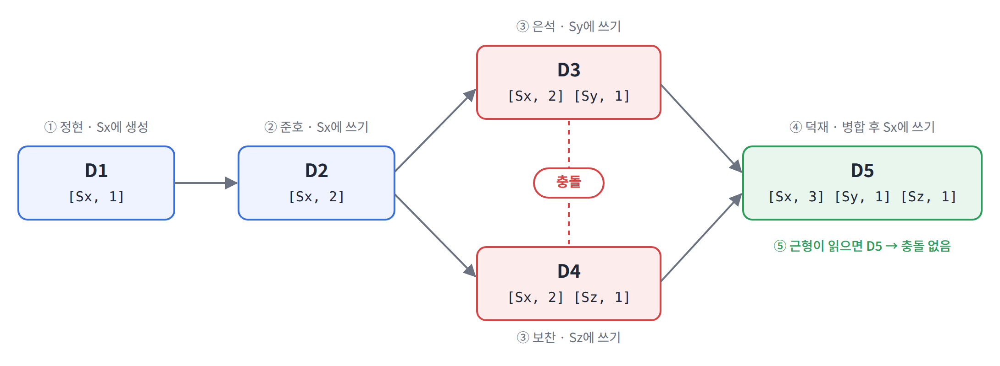

벡터 시계는 다음 규칙에 따라 갱신된다.

- 클라이언트는 데이터를 수정할 때, **자신이 읽었던 버전의 벡터 시계를 함께 전달**한다.
- 쓰기를 처리한 서버 `Si`는 전달받은 벡터 시계에 `[Si, vi]`가 있으면 `vi`를 1 증가시키고, 없으면 `[Si, 1]`을 새로 추가한다.

**① 정현이 데이터를 생성한다.**

정현이 서버 `Sx`에 새로운 데이터를 생성한다. `Sx`가 처음 처리한 쓰기이므로 `[Sx, 1]`이 추가된다.

`D1([Sx, 1])`

**② 준호가 데이터를 수정한다.**

준호가 `D1`을 읽고 수정한 뒤, 같은 서버 `Sx`에 저장한다. `Sx`의 카운터가 1 증가한다.

`D2([Sx, 2])`

`D2`의 모든 카운터가 `D1`보다 크거나 같으므로, `D2`는 `D1`의 후속 버전이다. 따라서 `D1`은 `D2`로 대체된다.

**③ 은석과 보찬이 각각 데이터를 수정한다.**

은석과 보찬이 모두 `D2`를 읽었다고 가정하자.

- 은석은 데이터를 수정하고 서버 `Sy`에 저장한다.
- 보찬은 데이터를 수정하고 서버 `Sz`에 저장한다.

두 사람 모두 `D2`의 벡터 시계 `[Sx, 2]`를 함께 전달했으므로, 각 서버는 이를 유지한 채 자신의 항목을 추가한다.

`D3([Sx, 2], [Sy, 1])`

`D4([Sx, 2], [Sz, 1])`

두 버전을 비교하면 다음과 같다.

| 서버 | D3 | D4 |
|---|---|---|
| `Sx` | 2 | 2 |
| `Sy` | 1 | 0 |
| `Sz` | 0 | 1 |

`D3`은 `Sy`에서 더 크고, `D4`는 `Sz`에서 더 크다. 어느 한쪽의 모든 카운터가 다른 쪽보다 크거나 같지 않으므로, **`D3`과 `D4` 중 어느 쪽이 더 최신 버전인지 판단할 수 없다.** 이를 **데이터 충돌**이라고 한다.

**④ 덕재가 충돌을 확인하고 해결한다.**

덕재가 데이터를 읽으면 `D3`과 `D4`를 함께 받는다. 벡터 시계를 비교하여 두 버전이 같은 `D2`에서 갈라져 독립적으로 수정되었다는 사실을 확인할 수 있다.

이때 저장소는 어느 한쪽을 임의로 최신이라고 판단하지 않는다. 덕재(클라이언트)가 두 버전의 내용을 확인하고 하나의 결과로 합친 뒤, 서버 `Sx`에 저장한다.

새로운 벡터 시계는 다음과 같이 만들어진다.

1. `D3`과 `D4`에서 서버별로 더 큰 값을 선택한다: `[Sx, 2], [Sy, 1], [Sz, 1]`
2. 쓰기를 처리한 `Sx`의 카운터를 1 증가시킨다.

`D5([Sx, 3], [Sy, 1], [Sz, 1])`

**⑤ 근형이 최신 데이터를 읽는다.**

이후 근형이 데이터를 읽으면 `D5`를 받는다.

`D5`의 모든 카운터는 `D3`과 `D4`의 대응하는 카운터보다 크거나 같다. 따라서 `D5`는 두 버전의 변경 이력을 모두 포함하는 **후속 버전**이며, 더 이상 충돌은 없다. `D3`과 `D4`는 `D5`로 대체된다.

**단계별 요약**

| 단계 | 사용자 | 읽은 버전 | 처리 서버 | 결과 |
|---|---|---|---|---|
| ① | 정현 | 없음 | `Sx` | `D1([Sx, 1])` |
| ② | 준호 | `D1` | `Sx` | `D2([Sx, 2])` |
| ③ | 은석 | `D2` | `Sy` | `D3([Sx, 2], [Sy, 1])` |
| ③ | 보찬 | `D2` | `Sz` | `D4([Sx, 2], [Sz, 1])` |
| ④ | 덕재 | `D3`, `D4` (충돌) | `Sx` | `D5([Sx, 3], [Sy, 1], [Sz, 1])` |
| ⑤ | 근형 | `D5` | 없음 (읽기) | 충돌 없음 |

#### 2. 버전 간 선후 관계 판단

두 버전 X, Y의 벡터 시계를 서버별로 비교한다. 한쪽에 없는 서버의 카운터는 0으로 본다.

**Y의 모든 카운터가 X의 대응하는 카운터보다 크거나 같으면, X는 Y의 이전 버전이다.**

예를 들어 다음 두 버전을 살펴보자.

- X: `D([Sx, 1], [Sy, 1])`
- Y: `D([Sx, 1], [Sy, 2])`

| 서버 | X | Y |
|---|---|---|
| `Sx` | 1 | 1 |
| `Sy` | 1 | 2 |

Y의 모든 카운터가 X보다 크거나 같다. 따라서 **X는 Y의 이전 버전이며, 두 버전 사이에는 충돌이 없다.** X는 Y로 대체할 수 있다.

#### 3. 데이터 충돌 판단

**어느 쪽도 다른 쪽의 모든 카운터보다 크거나 같지 않다면, 두 버전은 충돌한다.**

예를 들어 다음 두 버전을 살펴보자.

- X: `D([Sx, 1], [Sy, 2])`
- Y: `D([Sx, 2], [Sy, 1])`

| 서버 | X | Y |
|---|---|---|
| `Sx` | 1 | 2 |
| `Sy` | 2 | 1 |

X는 `Sx`에서 더 작지만 `Sy`에서는 더 크다. Y는 그 반대다.

따라서 **X와 Y 중 어느 한쪽이 다른 쪽의 후속 버전이라고 볼 수 없으며, 두 버전 사이에 충돌이 있다고 판단한다.**

이러한 충돌은 클라이언트가 해결한 뒤 결과를 저장소에 기록한다. 이때 새 벡터 시계는 1번 예시의 ④처럼 서버별 최댓값을 합친 뒤, 쓰기를 처리한 서버의 카운터를 1 증가시켜 만든다.

#### 4. 벡터 시계의 단점

벡터 시계에는 다음과 같은 단점이 있다.

- **클라이언트의 복잡성 증가:** 충돌을 감지한 뒤 해결하는 로직을 클라이언트에서 처리해야 하므로 클라이언트의 구현이 복잡해진다.
- **벡터 시계의 크기 증가:** 서버와 버전의 순서쌍이 계속 추가되면 벡터 시계의 크기가 커질 수 있다.

벡터 시계의 크기를 제한하기 위해 오래된 구성요소를 제거할 수 있지만, 이 경우 **버전 간 선후 관계를 정확하게 판단하기 어려워질 수 있다.**

아마존 Dynamo 관련 문헌에서는 실제 운영 환경에서 벡터 시계의 크기 증가 문제가 관찰되지 않았다고 설명한다.

**핵심 정리**

- **버저닝:** 데이터가 변경될 때마다 새로운 버전을 생성한다.
- **벡터 시계:** 버전 간 선후 관계를 추적하고 데이터 충돌을 감지한다.
- **충돌 해결:** 벡터 시계는 충돌을 감지하는 기법이며, 충돌 자체를 자동으로 해결하지는 않는다. 별도의 충돌 해결 로직이 필요하다.

---

### 장애 처리 (Failure Handling)

대규모 분산 시스템에서 장애는 피할 수 없을 뿐 아니라 **매우 자주 발생하는 일**이다. 따라서 장애를 어떻게 처리하느냐가 중요하다.

장애 처리는 다음 두 단계로 나누어 살펴본다.

- **장애 감지(Failure Detection):** 어떤 서버에 장애가 발생했는지 알아낸다.
- **장애 해소(Failure Resolution):** 장애가 발생한 상황에서도 시스템이 계속 동작하도록 처리한다.

#### 장애 감지 (Failure Detection)

분산 시스템에서는 서버 한 대가 "서버 A가 죽었다"고 보고했다는 이유만으로 서버 A를 장애 상태로 판단하지 않는다. 일시적인 네트워크 문제일 수도 있기 때문이다. 보통 **두 대 이상의 서버가 같은 서버의 장애를 보고해야** 실제 장애로 간주한다.

##### 멀티캐스팅 방식

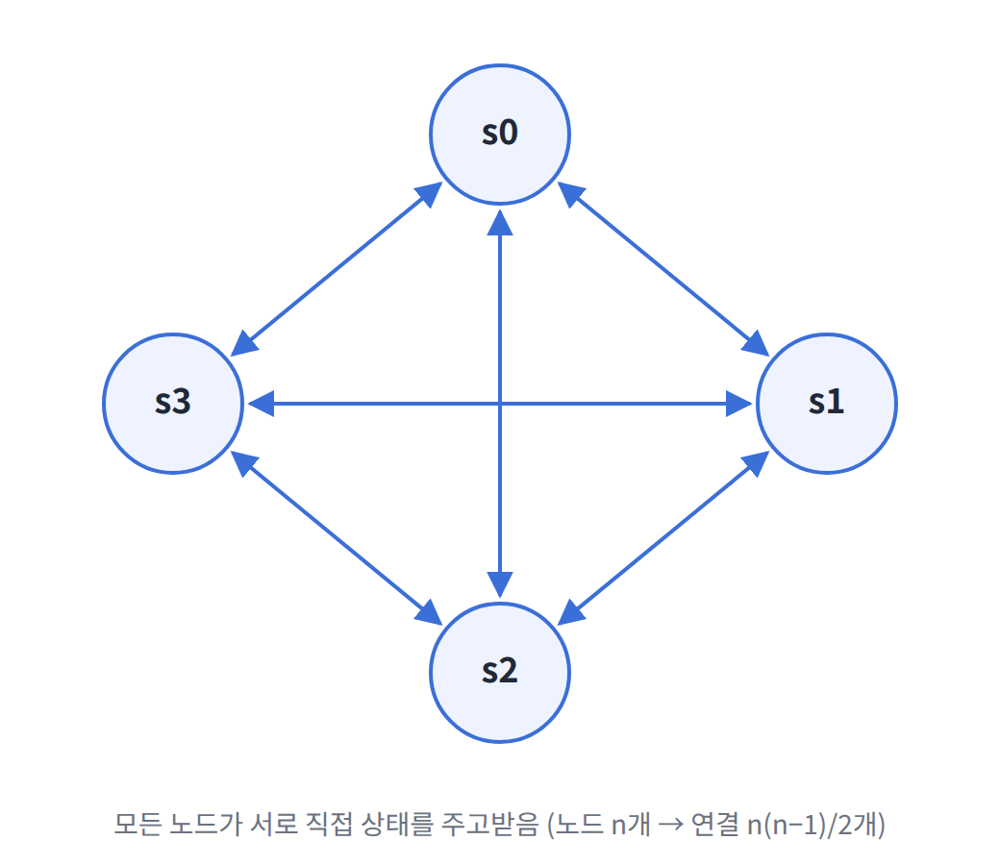

가장 단순한 방법은 **모든 노드 사이에 멀티캐스팅(Multicasting) 채널을 구축**하여 서로의 상태를 직접 확인하는 것이다.

하지만 노드 수가 늘어나면 연결 수가 급격히 많아지므로 **서버가 많을 때는 비효율적**이다.

##### 가십 프로토콜 (Gossip Protocol)

**가십 프로토콜은 분산형 장애 감지(Decentralized Failure Detection) 기법**으로, 노드들이 소문을 퍼뜨리듯 서로의 상태 정보를 주고받는다.

동작 원리는 다음과 같다.

1. 각 노드는 **멤버십 목록(Membership List)** 을 유지한다. 멤버십 목록은 각 멤버 ID와 **박동 카운터(Heartbeat Counter)** 의 쌍으로 구성된다.
2. 각 노드는 주기적으로 **자신의 박동 카운터를 증가**시킨다.
3. 각 노드는 주기적으로 **무작위로 선택한 노드들에게** 자신의 박동 카운터 목록을 전송한다.
4. 목록을 받은 노드는 자신의 멤버십 목록을 **최신 값으로 갱신**한다.
5. 어떤 멤버의 박동 카운터가 **지정된 시간 동안 갱신되지 않으면** 해당 멤버를 장애(Offline) 상태로 간주한다.

**예시**

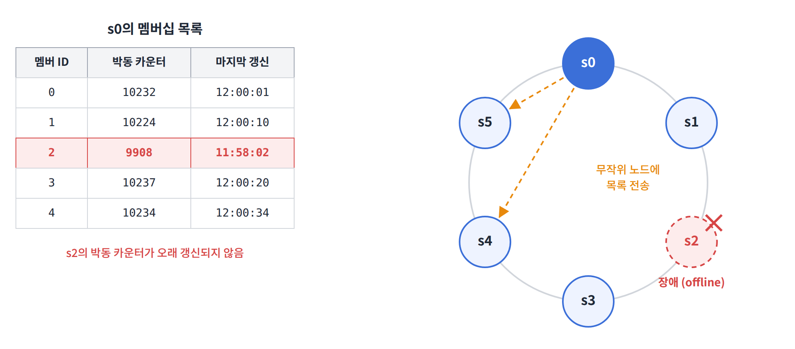

노드 `s0`이 다음과 같은 멤버십 목록을 가지고 있다고 가정하자. (현재 시각은 약 12:00:34)

| 멤버 ID | 박동 카운터 | 마지막 갱신 시각 |
|---|---|---|
| 0 | 10232 | 12:00:01 |
| 1 | 10224 | 12:00:10 |
| 2 | 9908 | **11:58:02** |
| 3 | 10237 | 12:00:20 |
| 4 | 10234 | 12:00:34 |

1. `s0`은 `s2`(멤버 ID 2)의 박동 카운터가 오랫동안 증가하지 않았다는 사실을 발견한다.
2. `s0`은 `s2`의 정보를 포함한 박동 카운터 목록을 무작위로 선택한 다른 노드들에게 전달한다.
3. 다른 노드들도 `s2`의 박동 카운터가 오랫동안 증가하지 않았음을 확인하면, `s2`를 **장애 노드로 표시**한다.

이처럼 한 노드의 판단만으로 결정하지 않고, **여러 노드가 정보를 공유하며 장애를 확정**한다.

#### 일시적 장애 처리

장애를 감지한 뒤에는 가용성을 유지하기 위한 조치가 필요하다.

##### 엄격한 정족수 vs 느슨한 정족수

- **엄격한 정족수(Strict Quorum):** 정족수를 채우지 못하면 앞서 데이터 일관성 절에서 설명한 것처럼 **읽기와 쓰기 연산을 금지**한다. 일관성은 지킬 수 있지만 가용성이 떨어진다.
- **느슨한 정족수(Sloppy Quorum):** 정족수 조건을 완화하여 **가용성을 높인다.** 해시 링에서 장애 서버를 무시하고, 쓰기를 처리할 **W개의 건강한 서버**와 읽기를 처리할 **R개의 건강한 서버**를 골라 요청을 처리한다.

##### 단서 후 임시 위탁 (Hinted Handoff)

장애 서버로 가야 할 요청은 **다른 서버가 잠시 대신 처리**한다.

이때 대신 처리한 서버는 "원래 이 데이터는 어느 서버의 것인지"에 대한 **단서(Hint)** 를 함께 남겨둔다. 장애 서버가 복구되면, 그동안 쌓인 변경사항을 원래 서버에 **일괄 반영**하여 데이터 일관성을 회복한다.

**예시**

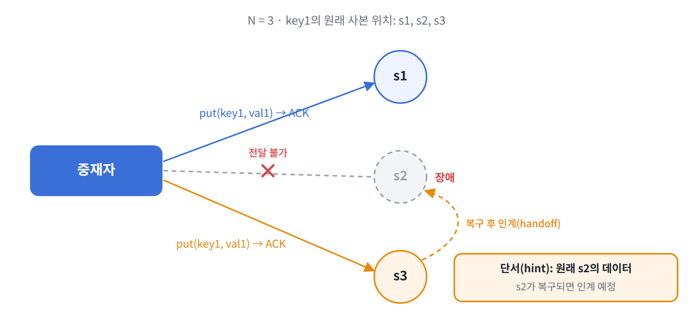

1. 노드 `s2`에 장애가 발생한다.
2. 중재자는 `s2`로 가야 할 `put(key1, val1)` 요청을 `s3`에 보낸다.
3. `s3`은 데이터를 저장하고, 이 데이터가 원래 `s2`의 것이라는 단서를 남긴다.
4. `s2`가 복구되면 `s3`은 갱신된 데이터를 `s2`에 **인계(Handoff)** 한다.

#### 영구 장애 처리

단서 후 임시 위탁은 **일시적 장애**를 위한 방법이다. 서버가 영구적으로 망가지거나 사본 사이의 차이가 오래 누적된 경우에는 **반-엔트로피(Anti-Entropy) 프로토콜**로 사본들을 동기화한다.

반-엔트로피 프로토콜은 **사본들을 비교하여 최신 버전으로 갱신**하는 과정이다. 이때 사본 간 불일치를 빠르게 찾고 전송할 데이터의 양을 줄이기 위해 **머클 트리(Merkle Tree)** 를 사용한다.

##### 머클 트리 (Merkle Tree)

**머클 트리는 해시 트리(Hash Tree)라고도 부르며, 각 노드의 레이블이 자식 노드들로부터 계산된 해시 값인 트리**다.

- **종단(Leaf) 노드:** 데이터 값의 해시를 레이블로 갖는다.
- **중간 노드:** 자식 노드들의 레이블을 합쳐 계산한 해시를 레이블로 갖는다.

이 구조를 사용하면 대규모 데이터의 내용을 **효율적이고 안전하게 검증**할 수 있다.

##### 머클 트리 생성 과정

키 공간(Key Space)이 1부터 12까지인 경우를 예로 들어보자.

**1단계: 키 공간을 버킷으로 나눈다.**

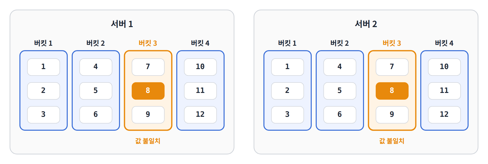

키 공간을 네 개의 버킷(Bucket)으로 나눈다. 그림에서 키 `8`은 두 서버의 값이 서로 다른 상태다.

| 버킷 | 포함된 키 |
|---|---|
| 버킷 1 | 1, 2, 3 |
| 버킷 2 | 4, 5, 6 |
| 버킷 3 | 7, 8, 9 |
| 버킷 4 | 10, 11, 12 |

**2단계: 각 키의 해시 값을 계산한다.**

버킷에 포함된 각 키에 **균등 분포 해시(Uniform Hash) 함수**를 적용하여 해시 값을 계산한다.

**3단계: 버킷별 해시 값을 계산한다.**

각 버킷에 속한 키들의 해시 값으로 버킷의 해시 값을 계산하고, 이를 레이블로 갖는 노드를 만든다.

**4단계: 상향식으로 이진 트리를 구성한다.**

자식 노드의 레이블로부터 새로운 해시 값을 계산하며, 루트(Root) 노드까지 이진 트리를 상향식으로 구성한다.

##### 머클 트리 비교 방법

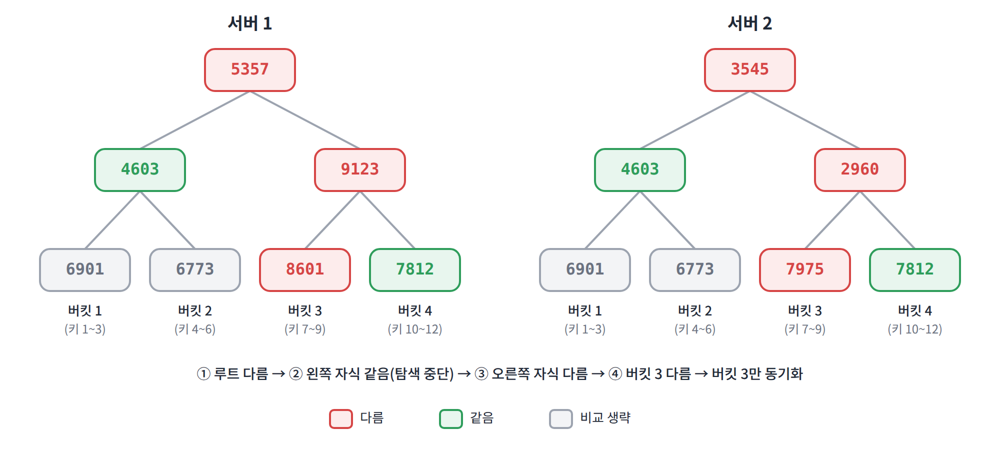

두 서버의 머클 트리는 **루트 노드부터 위에서 아래로** 비교한다.

1. 루트 노드의 해시 값을 비교한다. **같으면 두 서버의 데이터는 동일**하므로 비교를 끝낸다.
2. 다르면 왼쪽 자식 노드와 오른쪽 자식 노드의 해시 값을 각각 비교한다.
3. 해시 값이 다른 쪽으로만 계속 내려간다.
4. 최종적으로 **데이터가 다른 버킷**을 찾아 해당 버킷만 동기화한다.

그림의 예에서는 루트가 다르므로 자식을 비교한다. 왼쪽 자식(`4603`)은 같으므로 더 내려가지 않고, 오른쪽 자식만 따라 내려가 **버킷 3만 동기화**하면 된다.

##### 머클 트리의 장점과 주의점

- **장점:** 동기화할 데이터의 양이 **실제로 다른 부분의 크기에만 비례**하며, 서버에 저장된 전체 데이터의 양과는 무관하다.
- **주의점:** 실제 시스템에서는 버킷 하나의 크기가 꽤 크다. 예를 들어 10억(1B) 개의 키를 백만(1M) 개의 버킷으로 관리하면, 버킷 하나에 1,000개의 키가 들어간다.

#### 데이터 센터 장애 처리

데이터 센터 장애는 정전, 네트워크 장애, 자연재해 등 다양한 이유로 발생할 수 있다.

이에 대응하려면 **데이터를 여러 데이터 센터에 다중화**해야 한다. 그러면 한 데이터 센터가 완전히 망가져도 사용자는 다른 데이터 센터의 데이터를 이용할 수 있다.

---

### 시스템 아키텍처 다이어그램

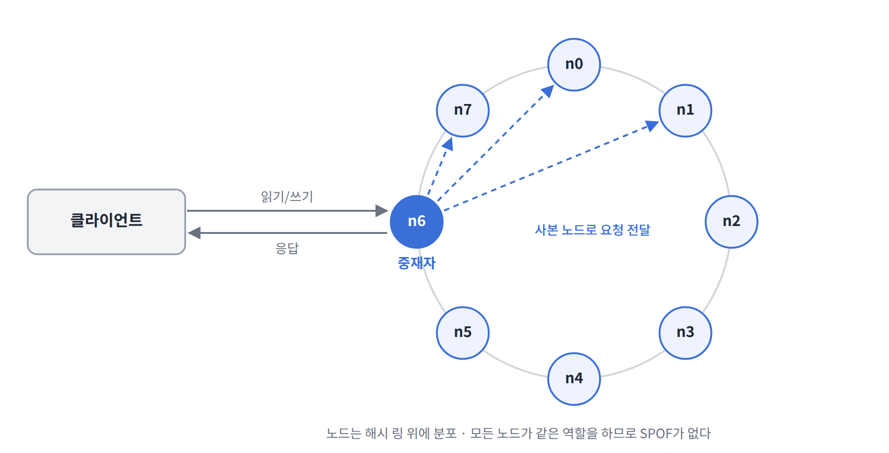

지금까지 살펴본 기술들을 종합하면 키-값 저장소의 아키텍처는 다음과 같은 특징을 갖는다.

- 클라이언트는 `get(key)`와 `put(key, value)` 두 가지 API로 키-값 저장소와 통신한다.
- **중재자(Coordinator)** 는 클라이언트에게 키-값 저장소에 대한 **프록시(Proxy)** 역할을 하는 노드다.
- 노드는 **안정 해시의 해시 링** 위에 분포한다.
- 노드를 자동으로 추가하거나 삭제할 수 있도록 시스템은 **완전히 분산(Decentralized)** 된다.
- 데이터는 **여러 노드에 다중화**된다.
- 모든 노드가 같은 책임을 지므로 **SPOF(Single Point of Failure, 단일 장애 지점)가 없다.**

#### 각 노드가 지원해야 하는 기능

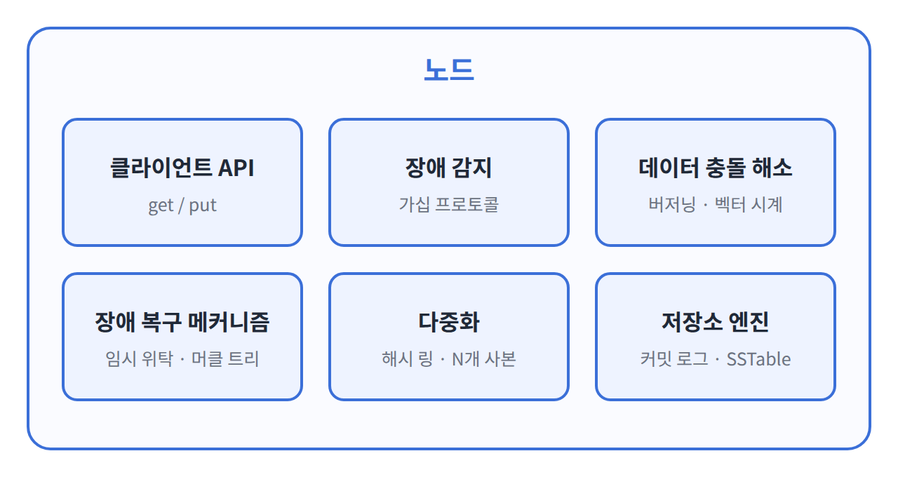

완전히 분산된 설계이므로 **모든 노드가 다음 기능을 전부 지원**해야 한다.

| 기능 | 설명 |
|---|---|
| 클라이언트 API | `get`, `put` 요청 처리 |
| 장애 감지 | 가십 프로토콜 |
| 데이터 충돌 해소 | 버저닝, 벡터 시계 |
| 장애 복구 메커니즘 | 단서 후 임시 위탁, 반-엔트로피 |
| 다중화 | 해시 링 기반 N개 사본 저장 |
| 저장소 엔진 | 메모리 캐시, 커밋 로그, SSTable |

---

### 쓰기 경로 (Write Path)

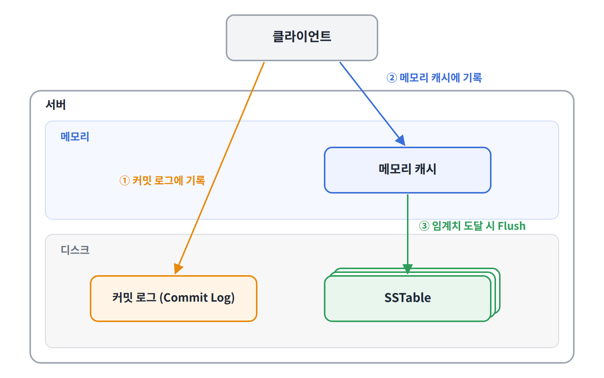

쓰기 요청이 노드에 전달되면 다음과 같이 처리된다. 이 구조는 **카산드라(Cassandra)** 의 사례를 참고한 것이다.

1. 쓰기 요청이 디스크의 **커밋 로그(Commit Log)** 파일에 기록된다.
2. 데이터가 **메모리 캐시**에 기록된다.
3. 메모리 캐시가 가득 차거나 미리 정한 임계치에 도달하면, 데이터를 디스크의 **SSTable**에 기록(Flush)한다.

**SSTable(Sorted-String Table)** 은 `<키, 값>` 쌍을 **키 순서로 정렬된 리스트** 형태로 저장하는 테이블이다.

커밋 로그에 먼저 기록하는 이유는, 메모리 캐시에만 있던 데이터가 서버 장애로 사라지더라도 **커밋 로그로 복구**할 수 있게 하기 위해서다.

---

### 읽기 경로 (Read Path)

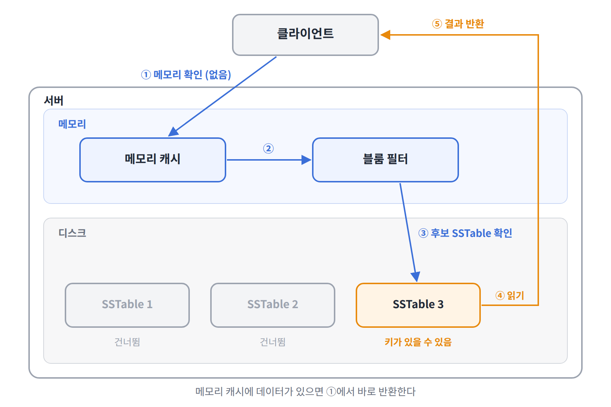

#### 데이터가 메모리에 있는 경우

읽기 요청을 받은 노드는 먼저 **메모리 캐시**를 확인한다. 데이터가 있으면 바로 클라이언트에게 반환한다.

#### 데이터가 메모리에 없는 경우

데이터가 메모리에 없으면 디스크의 SSTable에서 가져와야 한다. 이때 **어느 SSTable에 키가 있는지 효율적으로 찾기 위해 블룸 필터(Bloom Filter)** (어떤 값을 여러 해시 함수에 넣어 결과값들을 임의의 테이블에 인덱싱하여 해당되는 모든 값이 1인지를 따지는 자료구조) 를 사용한다.

1. 데이터가 메모리 캐시에 있는지 확인한다. 없으면 2단계로 간다.
2. **블룸 필터**를 검사한다.
3. 블룸 필터를 통해 키가 **있을 가능성이 있는 SSTable**을 알아낸다.
4. 해당 SSTable에서 데이터를 가져온다.
5. 데이터를 클라이언트에게 반환한다.

**블룸 필터의 특징:** 블룸 필터가 "없다"고 하면 키는 확실히 없지만, "있다"고 하면 실제로는 없을 수도 있다(거짓 양성, False Positive). 따라서 키가 확실히 없는 SSTable을 건너뛰어 **불필요한 디스크 읽기를 줄이는 용도**로 쓰인다.

---

## 요약

분산 키-값 저장소가 갖춰야 할 기능과 이를 구현하는 기술은 다음과 같다.

| 목표 / 문제 | 기술 |
|---|---|
| 대규모 데이터 저장 | 안정 해시를 사용해 서버들에 부하 분산 |
| 읽기 연산에 대한 높은 가용성 보장 | 데이터를 여러 데이터 센터에 다중화 |
| 쓰기 연산에 대한 높은 가용성 보장 | 버저닝 및 벡터 시계를 사용한 충돌 해소 |
| 데이터 파티션 | 안정 해시 |
| 점진적 규모 확장성 | 안정 해시 |
| 다양성(Heterogeneity) | 안정 해시 |
| 조절 가능한 데이터 일관성 | 정족수 합의(Quorum Consensus) |
| 일시적 장애 처리 | 느슨한 정족수(Sloppy Quorum)와 단서 후 임시 위탁(Hinted Handoff) |
| 영구적 장애 처리 | 머클 트리(Merkle Tree) |
| 데이터 센터 장애 대응 | 여러 데이터 센터에 걸친 데이터 다중화 |
